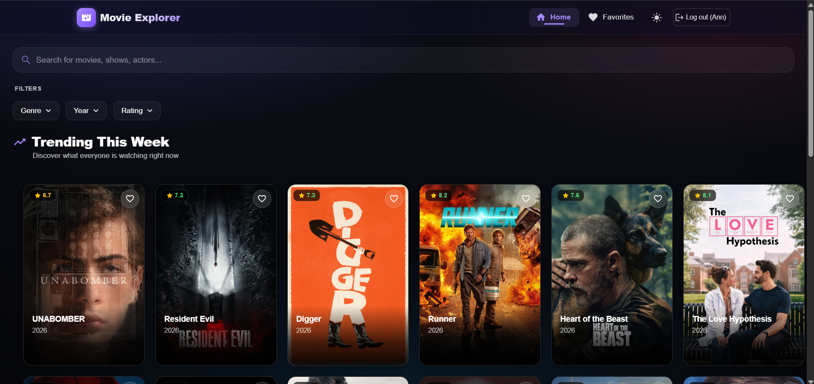
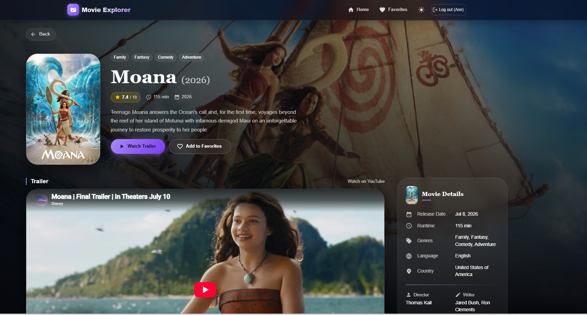
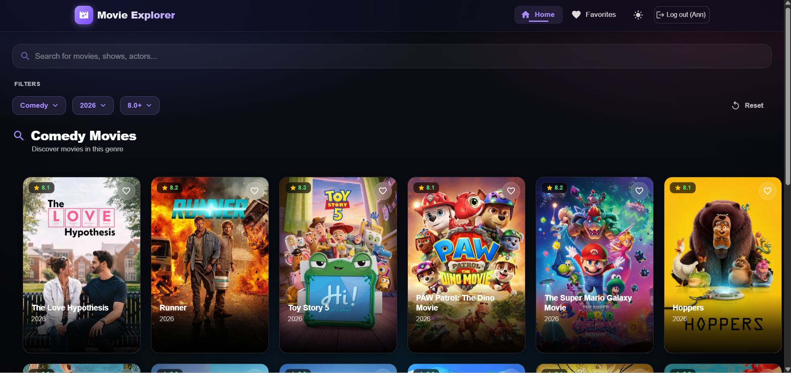
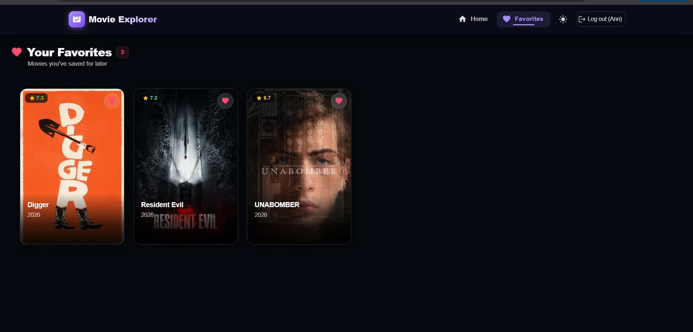
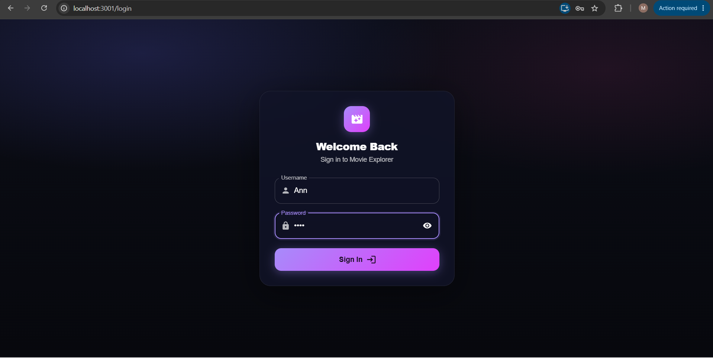
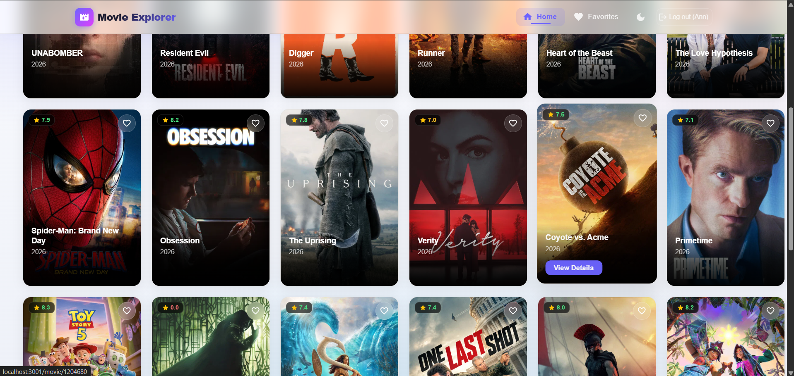

# Movie Explorer 🎬

A modern, visually stunning React application that allows users to discover trending movies, search for specific titles, explore detailed movie information, and save their favorite films. The app features a premium cinematic design with seamless dark/light modes and advanced filtering capabilities.

## Features

### Core Capabilities
- **Trending Movies**: Discover what everyone is watching right now on the homepage.
- **Movie Search**: Instantly search the extensive TMDb database for any movie title.
- **Advanced Filtering**: Filter movies effortlessly by Genre, Release Year, and Minimum Rating.
- **Infinite Scrolling**: Automatically load more movies as you scroll down the page, providing a seamless browsing experience without pagination buttons.
- **Movie Details**: View rich, cinematic details for any movie, including trailers, cast, runtime, budget, overview, and more.
- **Favorites System**: Save movies to a personal favorites list that persists locally on your device.

### UI / UX Highlights
- **Cinematic Design**: A stunning, custom Material-UI theme featuring glassmorphism elements, dynamic backgrounds, and smooth entrance micro-animations.
- **Light & Dark Mode**: Full support for both light and dark themes (defaults to Dark Mode), remembering user preferences.
- **Responsive Layout**: A mobile-first design approach ensuring the app looks and works perfectly on phones, tablets, and desktops (including a custom mobile navigation drawer).
- **Graceful Error Handling**: Friendly empty states and error messages if API requests fail or if a search yields no results.
- **Front-end Login**: A simple mock login gateway (requires a 4+ character password) to protect the main application view.

## Technologies Used

- **React** - Component-based UI library
- **Material-UI (MUI v5)** - Component library for responsive and accessible UI elements
- **React Router (v6)** - Declarative routing for React apps
- **Context API** - Global state management for user sessions, theme mode, and favorite movies
- **Axios** - Promise-based HTTP client for the browser to fetch API data
- **TMDb API** - The Movie Database API used as the backend data source

## Project Setup

Follow these steps to run the project locally on your machine.

### 1. Clone the repository
```bash
git clone https://gitlab.com/your-username/movie-explorer.git
cd movie-explorer
```

### 2. Install dependencies
```bash
npm install
```

### 3. Configure Environment Variables
Create a `.env` file in the root of the project (next to `package.json`) and add your TMDb API key. See the **Environment Variables** section below for details.

### 4. Start the application
```bash
npm start
```
The app will be available at [http://localhost:3000](http://localhost:3000).

## Environment Variables

To run this project, you will need to add the following environment variable to your `.env` file:

```env
REACT_APP_TMDB_API_KEY=your_tmdb_api_key_here
```

*Note: You can obtain a free API key by creating an account on [The Movie Database (TMDb)](https://www.themoviedb.org/documentation/api).*

## 🔌 TMDb API Usage

The application leverages several endpoints provided by The Movie Database to fetch data:
- `/trending/movie/week`: Fetches the current trending movies for the homepage.
- `/search/movie`: Searches the database based on user text input.
- `/discover/movie`: Used to filter movies precisely by genres, release year, and vote average.
- `/genre/movie/list`: Fetches the available movie genres to populate the filter dropdowns.
- `/movie/{movie_id}`: Retrieves comprehensive details about a specific movie (appended with `credits,videos` to fetch cast and trailers in a single request).

The API key is securely appended to every outgoing request using an Axios interceptor located in `src/api/tmdb.js`.

##  Project Structure

```text
src/
├── api/
│   └── tmdb.js           # Axios instance, interceptors, and API helper functions
├── components/
│   ├── FilterBar.jsx     # Premium dropdown filters for Genre, Year, Rating
│   ├── MovieCard.jsx     # Individual movie display cards
│   ├── MovieGrid.jsx     # Responsive grid container for displaying cards
│   ├── Navbar.jsx        # Top navigation with responsive mobile drawer
│   └── SearchBar.jsx     # Search input component
├── context/
│   └── AppContext.jsx    # Global state (User, Favorites, Theme Mode, Last Search)
├── pages/
│   ├── Favorites.jsx     # Displays user's saved movies
│   ├── Home.jsx          # Main landing page (Trending, Search, Filters, Infinite Scroll)
│   ├── Login.jsx         # Mock login portal
│   └── MovieDetails.jsx  # Rich cinematic detail view for a specific movie
├── App.js                # Routing setup and layout wrapper
└── index.css             # Global styles, fonts, and custom CSS animations
```

##  Screenshots

| Home Page (Dark Mode) | Movie Details |
|:---:|:---:|
|  |  |
| **Filters & Search** | **Favorites List** |
|  |  |

**Login Page**  


**Light Mode Interface**  


##  Deployment

The application is fully prepared for production deployment and is currently hosted on Netlify.

**Live Demo:** [Insert Netlify App Link Here]

## 🔗 Repository

**GitLab Repository:** [https://gitlab.com/fathiiminha67/movie-explorer.git](https://gitlab.com/fathiiminha67/movie-explorer.git)

---
*Developed with clean code and modern UI principles.*
